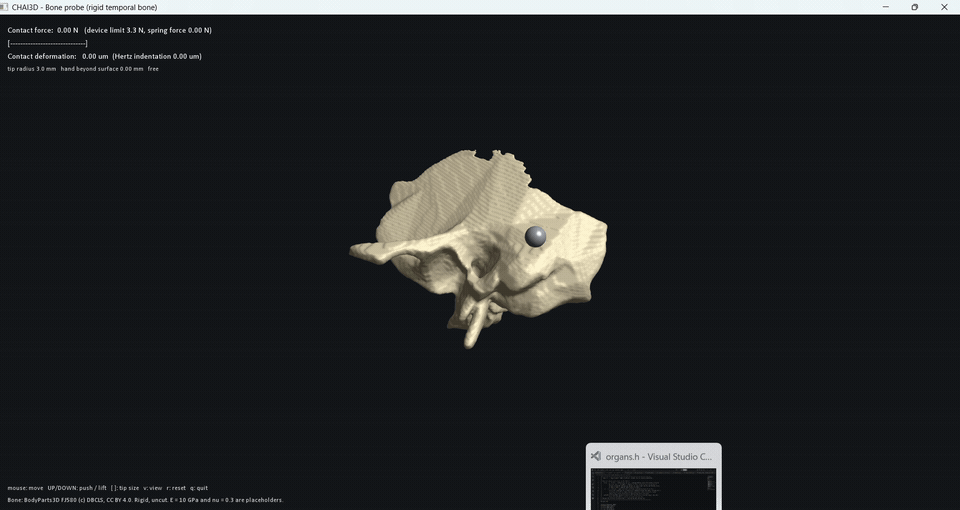
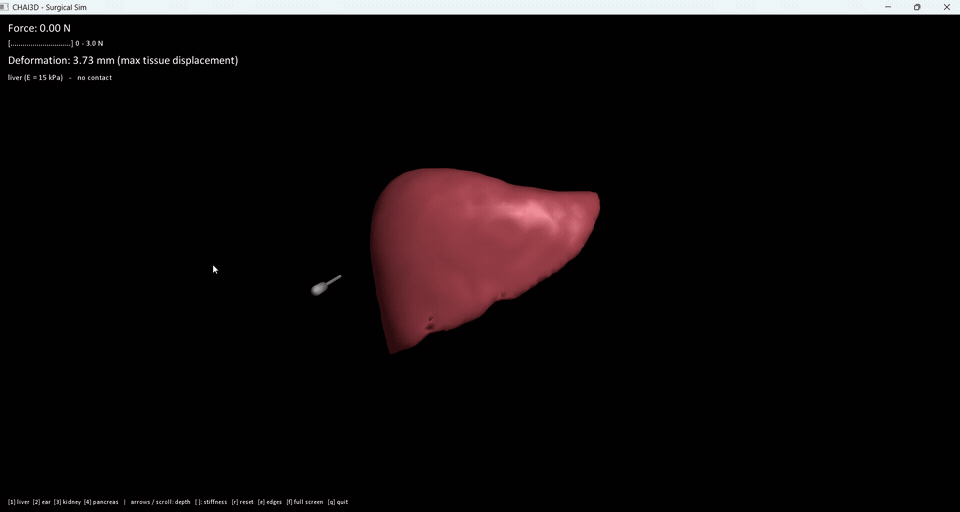
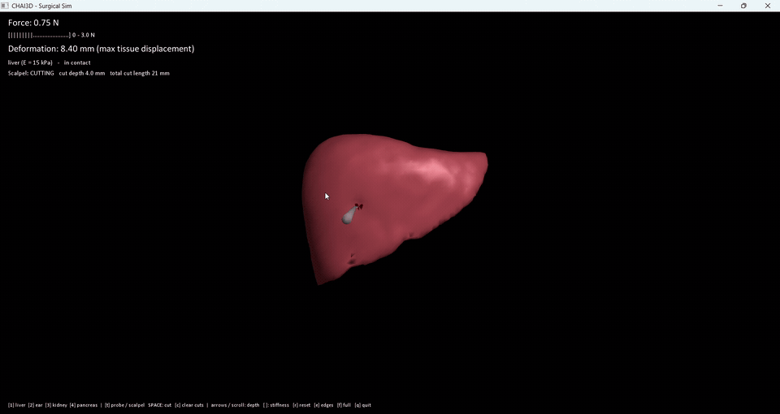
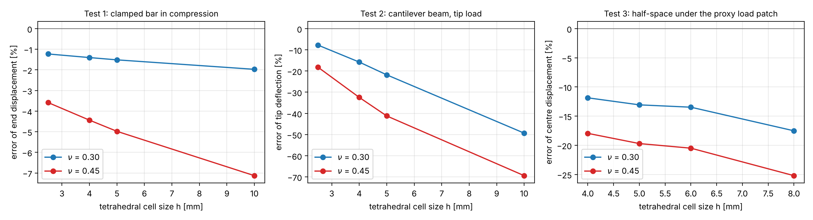

# Haptic-Assisted Surgical Simulation

### Tensor-Mass Tissue Modelling, Surgical Instrument Interaction and Numerical Verification

## Overview

Surgical simulation requires computational models capable
of representing anatomical structures, biological tissue
deformation and instrument–tissue interaction within an
interactive virtual environment.

This project investigates physics-based approaches to
surgical simulation, combining volumetric anatomical
modelling, computational tissue mechanics, contact-force
estimation and surface incision modelling.

This work is from my master's research in 2023
on haptic-assisted surgical simulation, involving Unity3D,
anatomical visualization and a Phantom Omni haptic device.

This C++ implementation presents the computational
aspects of that research using CHAI3D, with particular
emphasis on mechanical modelling, numerical stability
and verification against analytical solutions.

## Research Objectives

- Investigate computationally efficient representations
  of rigid and deformable biological tissues.
- Implement physics-based tissue deformation using
  the tensor-mass formulation.
- Model surgical instrument contact and estimate
  interaction forces.
- Investigate surface incision and cutting-force
  estimation.
- Evaluate numerical accuracy, mesh sensitivity
  and limitations of the computational models.

## Key Technical Contributions

| Component | Computational Approach |
|---|---|
| Anatomical modelling | Voxel and tetrahedral representations |
| Tissue mechanics | Linear-elastic tensor-mass formulation |
| Numerical integration | Explicit central-difference scheme |
| Numerical stability | Spectral timestep estimation |
| Computational optimization | Precomputed stiffness tensors and multithreading |
| Rigid tissue interaction | Constrained contact and Hertzian indentation |
| Soft-tissue interaction | Virtual proxy and distributed surface loading |
| Surgical incision | Fracture-energy-based force estimation |
| Numerical verification | Analytical benchmarks and mesh refinement |

## Simulation Applications

### 1. Rigid Temporal Bone Interaction

Interactive probing of a three-dimensional temporal
bone model using a rigid anatomical representation.

The application investigates contact-force estimation
and analytical indentation without explicitly integrating
the deformation of highly stiff bone.

  

  <em>Interactive temporal bone probing using a rigid
  anatomical representation.</em>

**Features**

- Voxel-based anatomical representation.
- Constrained virtual instrument interaction.
- Contact-force and indentation estimation.
- Interaction data logging.

[Explore the temporal bone simulation](examples/42-bone-probe/)

### 2. Deformable Soft-Tissue Simulation

Physics-based deformation of anatomically shaped
soft tissues using volumetric tetrahedral meshes
and a linear-elastic tensor-mass formulation.

The virtual proxy couples instrument motion to
distributed tissue loading, producing a mechanically
computed deformation response.

  

  <em>Interactive liver deformation using the tensor-mass
  formulation and proxy-based instrument contact.</em>

**Features**

- Multiple anatomical tissue models.
- Material-dependent mechanical response.
- Proxy-based surgical palpation.
- Multithreaded deformation computation.
- Force and displacement estimation.

[Explore the soft-organ simulation](examples/43-soft-organ-probe/)

### 3. Soft-Tissue Scalpel Simulation

An extension of the deformable tissue framework
for investigating surgical surface incision.

The application combines tissue deformation with
fracture-energy-based cutting-force estimation
and surface-anchored incision geometry.

  

  <em>Surface incision modelling with fracture-energy-based
  force estimation and deformation-dependent incision geometry.</em>

**Features**

- Probe and scalpel interaction modes.
- Shallow surface incision modelling.
- Cutting-force estimation.
- Deformation-dependent incision visualization.

The underlying volumetric mesh remains unchanged
during surface incision.

[Explore the scalpel simulation](examples/44-soft-organ-scalpel/)

## Anatomical Models

| Anatomical Structure | Young's Modulus | Representation |
|---|---:|---|
| Temporal bone | 10 GPa | Rigid voxel model |
| Ear cartilage | 1.66 MPa | Deformable tetrahedral mesh |
| Kidney | 19.6 kPa | Deformable tetrahedral mesh |
| Liver | 15 kPa | Deformable tetrahedral mesh |
| Pancreas | 1.4 kPa | Deformable tetrahedral mesh |

The material parameters represent literature-informed
values and modelling assumptions rather than
patient-specific measurements.

[Material parameters and references](docs/MATERIALS.md)

## Computational Framework

The framework separates anatomical geometry processing,
mechanical modelling, instrument interaction and
graphical visualization.

The deformable tissue solver computes internal forces
using preassembled stiffness tensors and advances
nodal positions through explicit numerical integration.

The contact model estimates instrument reaction forces
and distributes external loads across the tissue surface.

Detailed formulations and computational workflows
are documented separately:

- [Computational Methodology](docs/METHODOLOGY.md)
- [System Architecture](docs/ARCHITECTURE.md)

## Numerical Verification

The tensor-mass solver was evaluated through three
analytical benchmark experiments and an additional
assessment of the integrated proxy contact model.

The analytical benchmarks investigated mesh sensitivity
at Poisson's ratios of 0.30 and 0.45.

### Displacement Error at the Finest Tested Resolution

| Benchmark | Cell Size | Error at ν = 0.30 | Error at ν = 0.45 |
|---|---:|---:|---:|
| Uniaxial compression | 2.5 mm | 1.23% | 3.59% |
| Cantilever bending | 2.5 mm | 7.77% | 18.20% |
| Distributed indentation | 4.0 mm | 11.86% | 17.95% |

Errors are reported as absolute percentage deviations
from the corresponding analytical reference solutions.

### Principal Findings

- Mesh refinement reduced displacement error across
  all six analytical benchmark configurations.
- Uniaxial compression demonstrated the closest
  agreement with the analytical reference solution.
- Cantilever bending exhibited substantial
  mesh-dependent stiffness at coarse resolutions.
- Higher Poisson's ratios produced larger errors,
  consistent with limitations of constant-strain
  tetrahedral elements.
- The integrated proxy contact experiments revealed
  discrepancies between proxy indentation and tissue
  displacement, including unsteady contact in two
  of the four tested configurations.

The integrated contact model is therefore treated
as a qualitative interaction model rather than
a quantitatively validated contact solution.

[Full numerical verification report](validation/README.md)

## Repository Structure

    surgical-simulation-with-haptics/
    |
    |-- docs/
    |   |-- METHODOLOGY.md
    |   |-- ARCHITECTURE.md
    |   `-- MATERIALS.md
    |
    |-- examples/
    |   |-- 42-bone-probe/
    |   |-- 43-soft-organ-probe/
    |   `-- 44-soft-organ-scalpel/
    |
    |-- validation/
    |   |-- figures/
    |   |-- results/
    |   `-- README.md
    |
    |-- tools/
    |-- assets/
    |-- ACKNOWLEDGEMENTS.md
    `-- README.md

## Technologies

- C++
- Python
- CHAI3D
- OpenGL
- GLFW
- Unity3D (original master's research)
- Phantom Omni (original haptic hardware)

## Research Scope and Limitations

The computational models employ simplified material
assumptions and numerical approximations intended
for research into interactive surgical simulation.

The numerical experiments establish selected
properties of the deformation model but do not
constitute clinical or experimental tissue validation.

The original Phantom Omni interface is not included
in the archived implementation. The available C++
applications use mouse-controlled interaction and
compute estimated reaction forces.

This repository is maintained as a technical record
of research and computational development rather
than a standalone software distribution.
