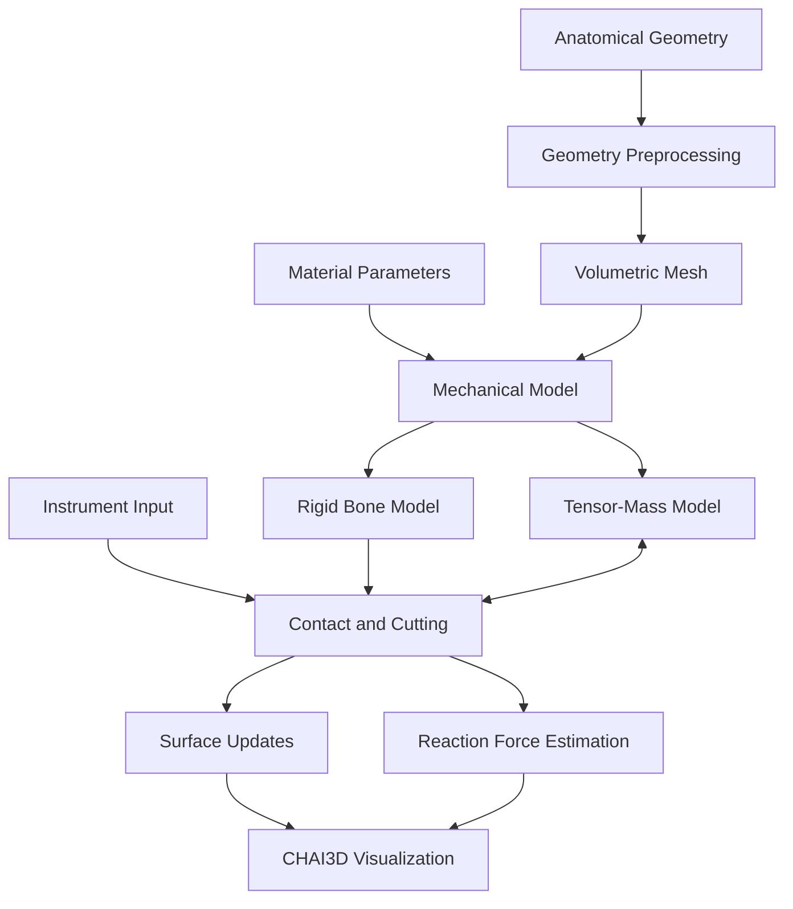
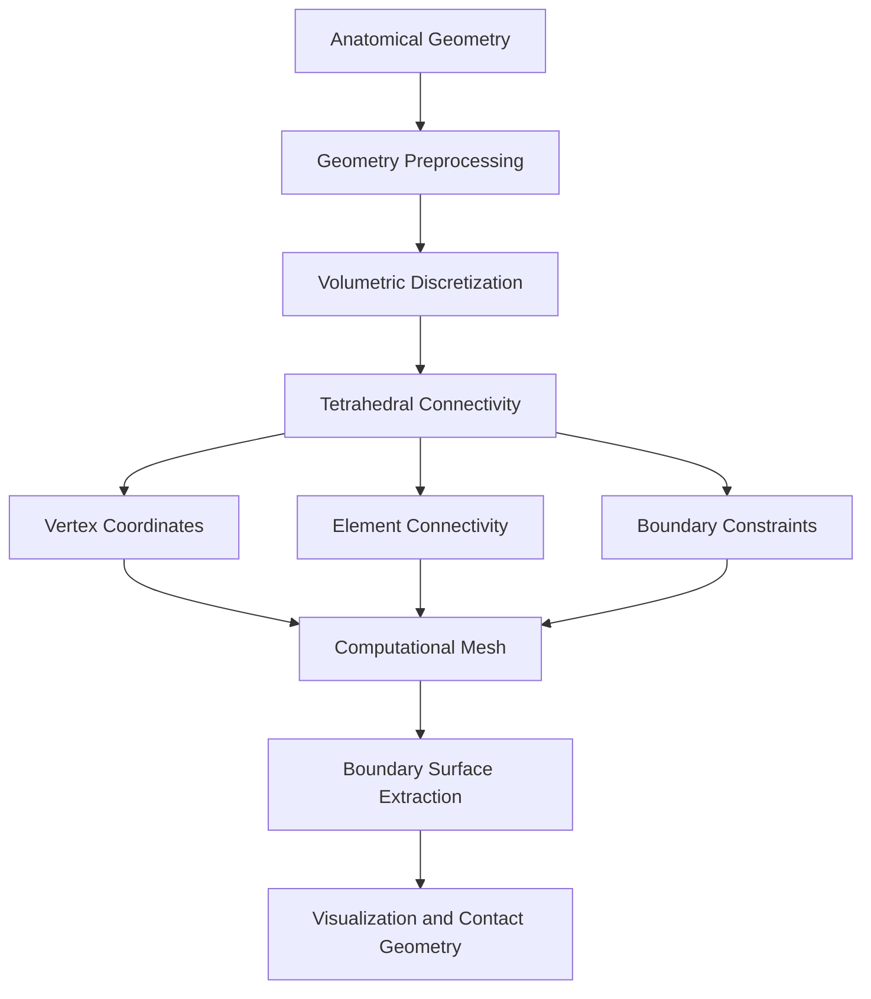
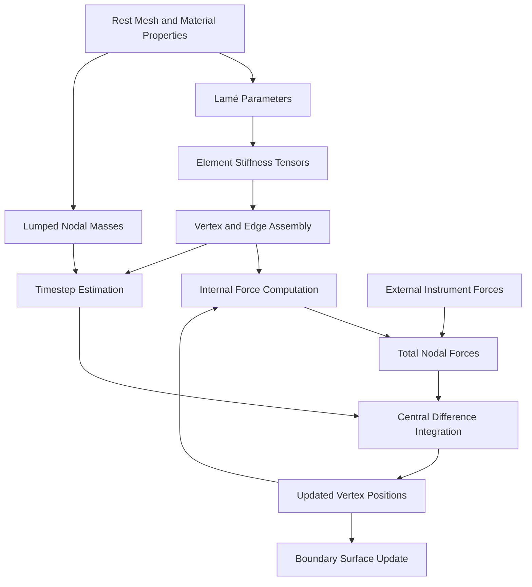
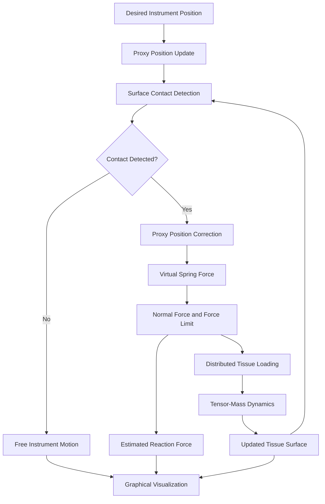
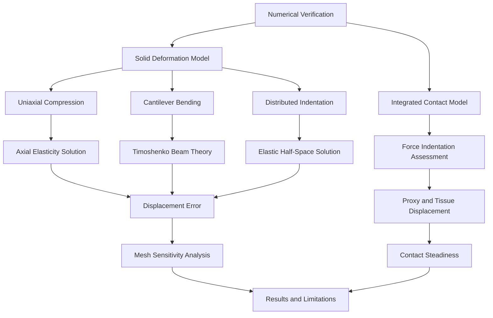

# System Architecture

## Overview

The surgical simulation framework separates anatomical
geometry processing, mechanical modelling, instrument
interaction and graphical visualization.

This document describes the computational architecture
and information flow between the principal components.

For mathematical formulations, refer to the
[Computational Methodology](METHODOLOGY.md).

## 1. Overall System Architecture

The framework adopts a rigid approximation for intact
bone and a deformable tensor-mass representation for
soft tissues.

Instrument interaction is coupled to the mechanical
model through contact forces and geometry updates.

## 2. Anatomical Geometry Processing

The computational representation contains vertex
coordinates, tetrahedral connectivity and constrained
boundary vertices.

The exposed surface provides the geometry required
for visualization and instrument contact.

Geometry preprocessing utilities are retained in
the [tools directory](../tools/).

## 3. Tensor-Mass Solver

The mechanical solver uses precomputed stiffness
tensors, lumped nodal masses and explicit numerical
integration.

Internal force computation and nodal position updates
form the principal deformation loop.

## 4. Instrument–Tissue Interaction

The deformable tissue interaction model distinguishes
between the desired instrument position and its
constrained proxy position.

The estimated contact force is distributed across
the tissue surface. The resulting deformation
subsequently influences the contact configuration.

The original Phantom Omni hardware interface is
not included in this repository.

## 5. Numerical Verification Framework

The solid deformation model is assessed through
comparisons with analytical reference solutions.

The integrated contact model is assessed separately
through force–indentation consistency and contact
steadiness.

The verification framework operates independently
of the graphical application.

Detailed results are available in the
[Numerical Verification Report](../validation/README.md).

## 6. Principal Implementation Components

| Component | Responsibility |
|---|---|
| `tensor_mass.h` | Tensor-mass formulation and stiffness assembly |
| `tensor_mass_dynamics.h` | Force computation and numerical integration |
| `surgical_sim.h` | Instrument interaction and geometry updates |
| `tools/` | Anatomical geometry preprocessing |
| `examples/` | Graphical surgical simulation applications |
| `validation/` | Numerical verification and experimental records |

## Related Documentation

- [Computational Methodology](METHODOLOGY.md)
- [Material Parameters](MATERIALS.md)
- [Numerical Verification](../validation/README.md)
- [Simulation Applications](../examples/)
- [Project Overview](../README.md)
