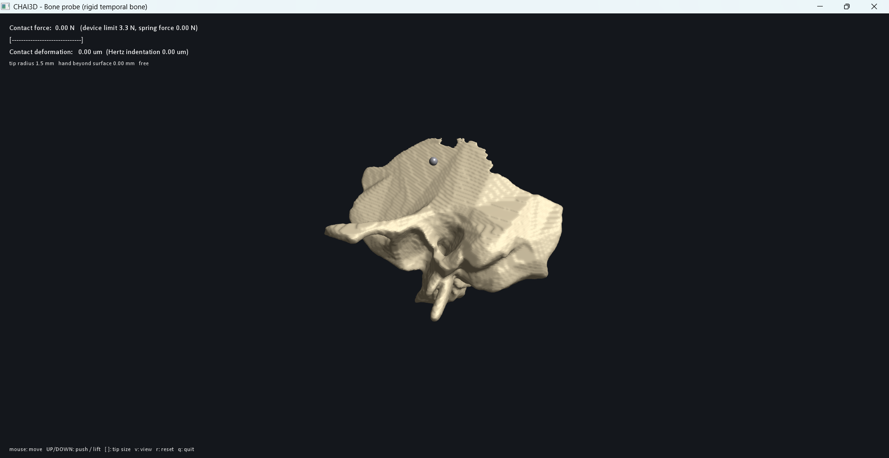
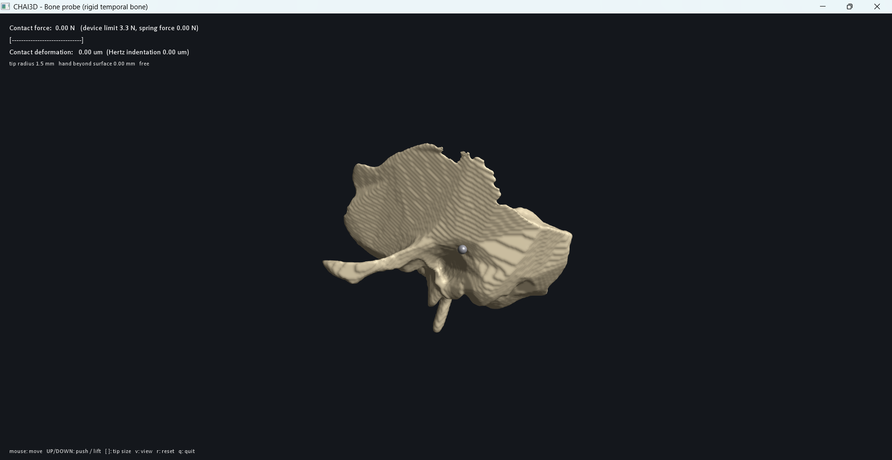
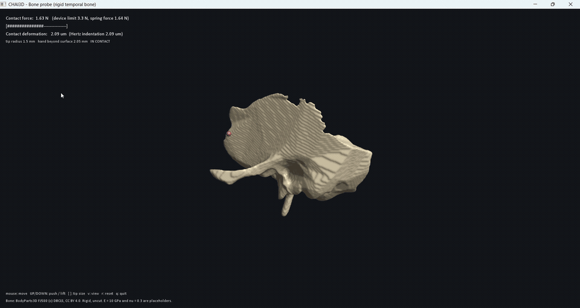
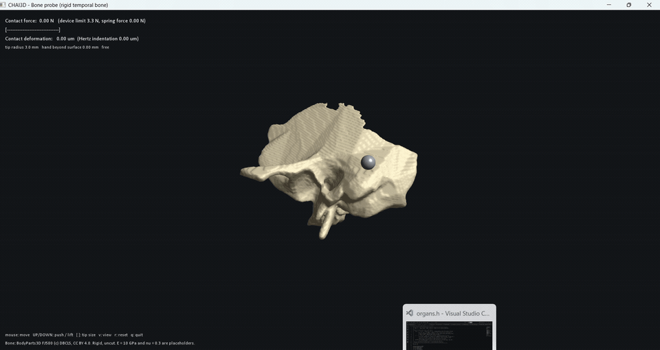

# Rigid Temporal Bone Simulation

## Overview

This application investigates instrument–bone interaction
using a three-dimensional anatomical model of the left
temporal bone.

A rigid approximation is adopted to avoid the restrictive
numerical timestep requirements associated with explicit
elastic simulation of highly stiff biological materials.

## Computational Approach

- Voxel-based anatomical representation with 0.5 mm resolution.
- Surface reconstruction using marching cubes.
- Constrained virtual probe interaction.
- Spring-based contact-force estimation.
- Hertzian contact indentation estimation.
- Configurable instrument-force limits.

The anatomical structure is treated as rigid, while
localized contact deformation is estimated analytically.

## Key Features

- Interactive three-dimensional anatomical visualization.
- Mouse-controlled surgical probe.
- Contact-force visualization in Newtons.
- Contact deformation readout in micrometres.
- Continuous CSV logging of interaction measurements.
- Distinction between free motion and surface contact.

## Visual Demonstrations

### Anatomical Visualization

| Anatomical view 1 | Anatomical view 2 |
| :---: | :---: |
|  |  |

Alternative viewing perspectives of the voxel-derived
temporal bone surface.

### Interactive Instrument Probing

  

  <em>Interactive probe movement and anatomical contact.</em>

  

  <em>Instrument interaction with contact-force and
  analytical indentation readouts.</em>

The displayed forces and indentation values are
computational estimates rather than physical
measurements from a haptic device.

## Implementation

| File | Responsibility |
|---|---|
| `42-bone-probe.cpp` | Graphical application and instrument interaction |
| `voxel_bone.h` | Voxel representation and contact mechanics |
| `make_bone_voxels.py` | Anatomical geometry preprocessing |
| `temporal_bone_voxels.bin` | Volumetric anatomical representation |
| `temporal_bone_surface.bin` | Reconstructed anatomical surface |

## Limitations

The rigid approximation does not simulate distributed
elastic deformation of bone.

Hertzian indentation provides an analytical estimate
rather than a directly measured physical deformation.

This application focuses on probing and contact-force
estimation rather than drilling or bone fracture.

The original physical haptic-device interface is not
included in the archived implementation.

## Anatomical Data

Temporal bone geometry: BodyParts3D, FJ580.

Copyright: The Database Center for Life Science.
Attribution: Creative Commons Attribution 4.0 International,
as recorded in the original project documentation.

## Related Documentation

- [Computational Methodology](../../docs/METHODOLOGY.md)
- [System Architecture](../../docs/ARCHITECTURE.md)
- [Material Parameters](../../docs/MATERIALS.md)
- [Project Overview](../../README.md)
