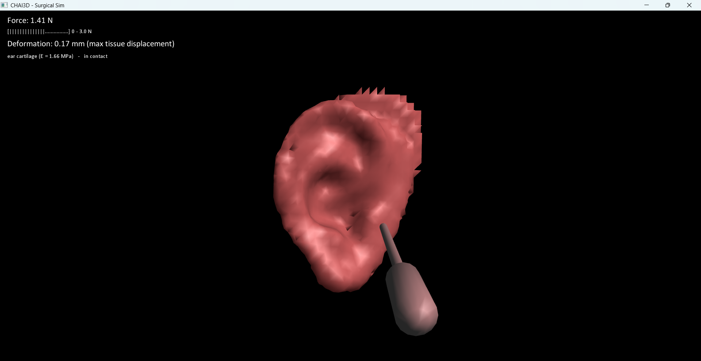
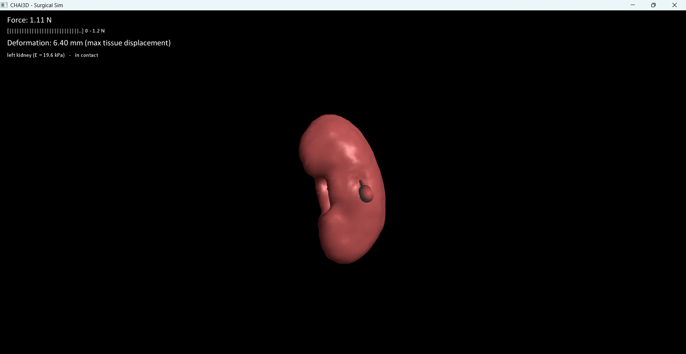
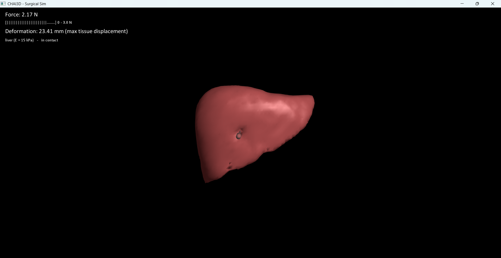
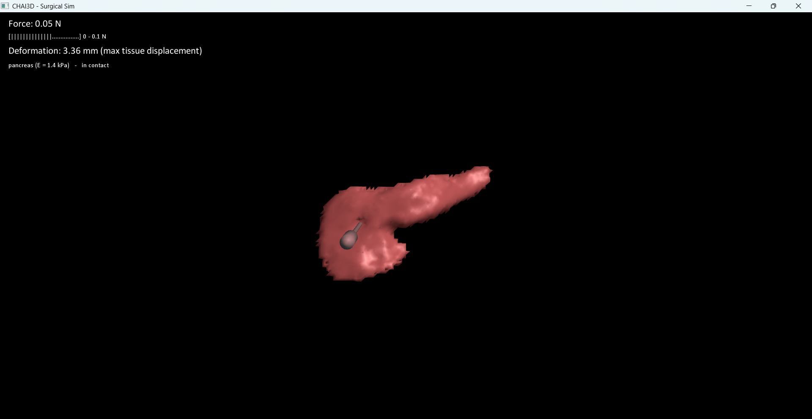
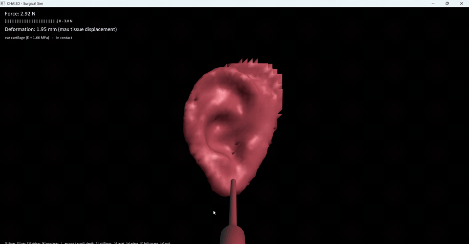
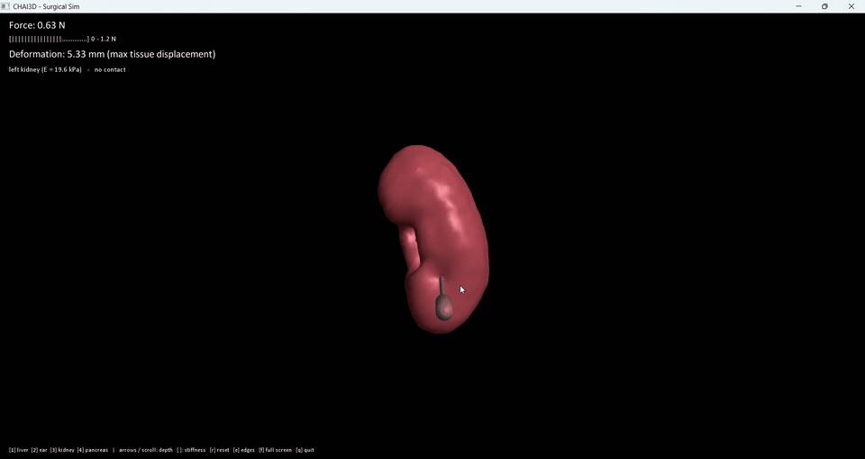
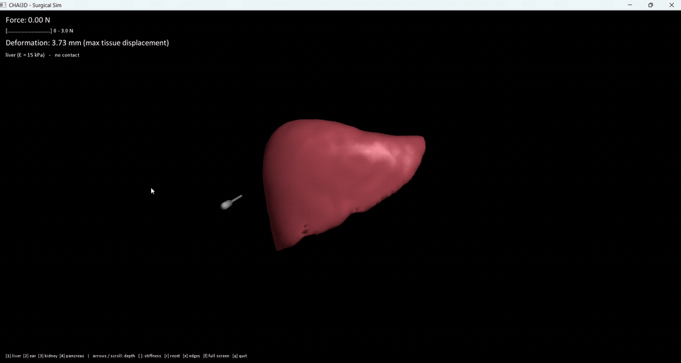
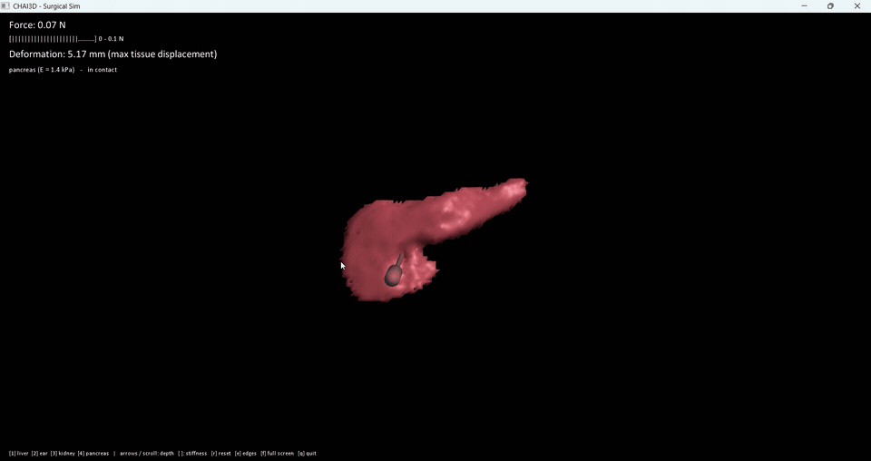
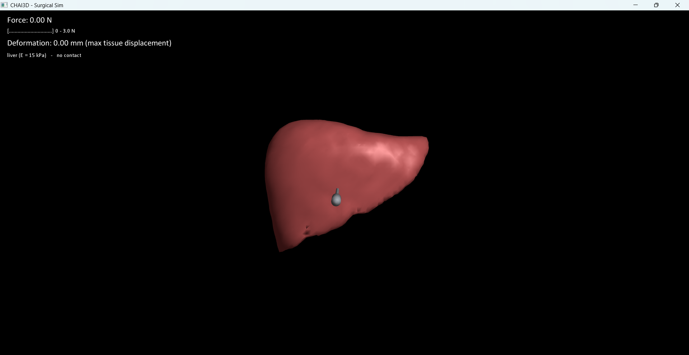
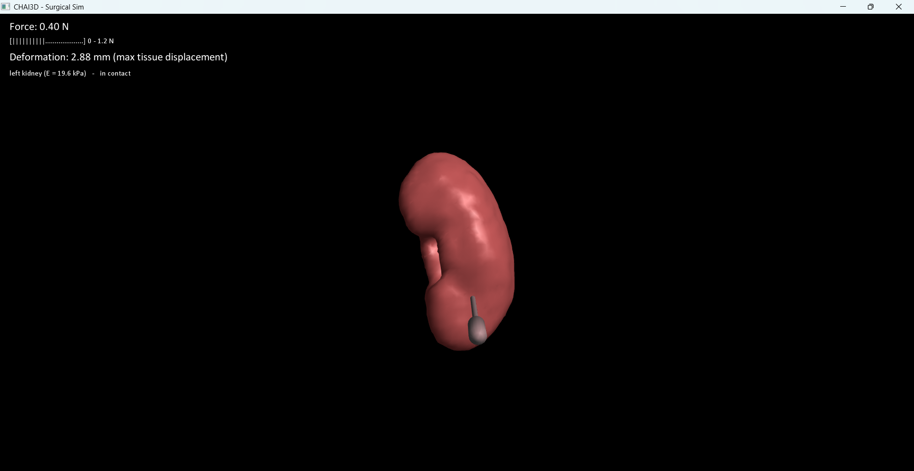

# Deformable Soft-Organ Simulation

## Overview

This application investigates interactive soft-tissue
deformation and surgical instrument contact using
anatomically shaped volumetric meshes.

The tensor-mass formulation is employed to represent
the mechanical response of deformable biological tissue.

## Anatomical Models

| Tissue | Young's modulus |
|---|---:|
| Liver | 15 kPa |
| Ear cartilage | 1.66 MPa |
| Left kidney | 19.6 kPa |
| Pancreas | 1.4 kPa |

Material parameters are adopted from published literature
and modelling assumptions, as detailed in the material
parameter documentation.

## Computational Approach

- Linear-elastic tensor-mass formulation.
- Volumetric tetrahedral discretization.
- Precomputed vertex and edge stiffness tensors.
- Lumped nodal masses.
- Explicit central-difference integration.
- Multithreaded internal force computation.
- Proxy-based instrument contact.
- Distributed surface loading.

The instrument interaction model couples the desired
probe position to a constrained virtual proxy through
a virtual spring.

The resulting contact load is distributed across
nearby tissue vertices, producing a deformation
response governed by the tensor-mass model.

## Key Features

- Interactive selection between four anatomical models.
- Mouse-controlled surgical palpation.
- Material stiffness adjustment.
- Tissue deformation visualization.
- Contact-force estimation in Newtons.
- Maximum tissue displacement measurement.
- Mesh-edge visualization.
- Tissue-specific force limits.

## Visual Demonstrations

### Anatomical Models

| Ear cartilage | Left kidney |
| :---: | :---: |
|  |  |
| E = 1.66 MPa | E = 19.6 kPa |
| **Liver** | **Pancreas** |
|  |  |
| E = 15 kPa | E = 1.4 kPa |

### Interactive Tissue Deformation

| Ear cartilage | Left kidney |
| :---: | :---: |
|  |  |
| **Liver** | **Pancreas** |
|  |  |

The demonstrations illustrate interactive instrument
contact and deformation across anatomical models with
different assigned material properties.

### Loaded and Unloaded Configurations

| Unloaded liver | Loaded liver |
| :---: | :---: |
|  |  |
| Force: 0.00 N | Force: 2.17 N |
| Displacement: 0.00 mm | Displacement: 23.41 mm |

### Kidney Interaction at Different Loads

| Lower applied load | Higher applied load |
| :---: | :---: |
|  |  |
| Force: 0.40 N | Force: 1.11 N |
| Displacement: 2.88 mm | Displacement: 6.40 mm |

### Representative Simulation Outputs

| Tissue | Young's modulus | Contact force | Maximum displacement |
|---|---:|---:|---:|
| Ear cartilage | 1.66 MPa | 1.41 N | 0.17 mm |
| Kidney | 19.6 kPa | 1.11 N | 6.40 mm |
| Liver | 15 kPa | 2.17 N | 23.41 mm |
| Pancreas | 1.4 kPa | 0.05 N | 3.36 mm |

These values are individual observations recorded
during interactive simulation.

They are not controlled comparative measurements:
applied loads, contact locations, anatomical geometry
and boundary conditions differ between demonstrations.

Large displacement observations should also be
interpreted with caution given the underlying
small-strain linear-elastic formulation.

For quantitative assessment of the mechanical model,
refer to the [Numerical Verification](../../validation/README.md).

## Implementation

| File | Responsibility |
|---|---|
| `43-soft-organ-probe.cpp` | Graphical application |
| `tensor_mass.h` | Mechanical model and stiffness assembly |
| `tensor_mass_dynamics.h` | Numerical integration |
| `surgical_sim.h` | Proxy contact and tissue interaction |
| `organs.h` | Anatomical model configurations |
| `mesh_*.h` | Volumetric anatomical meshes |

## Numerical Verification

The underlying deformation model was investigated
through analytical comparisons involving uniaxial
compression, cantilever bending and distributed
indentation.

The integrated proxy contact model was assessed
separately to identify force–indentation discrepancies
and contact stability limitations.

## Limitations

The model assumes homogeneous, isotropic,
linear-elastic tissue behaviour.

Deformation accuracy depends on mesh resolution,
material parameters and boundary conditions.

The integrated contact model is intended for
qualitative interaction rather than quantitatively
validated biological tissue palpation.

Physical haptic feedback is not included in the
available implementation.

## Related Documentation

- [Computational Methodology](../../docs/METHODOLOGY.md)
- [System Architecture](../../docs/ARCHITECTURE.md)
- [Material Parameters](../../docs/MATERIALS.md)
- [Numerical Verification](../../validation/README.md)
- [Project Overview](../../README.md)
