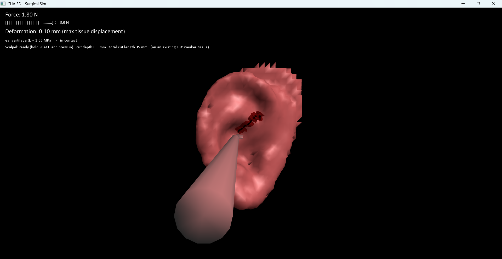
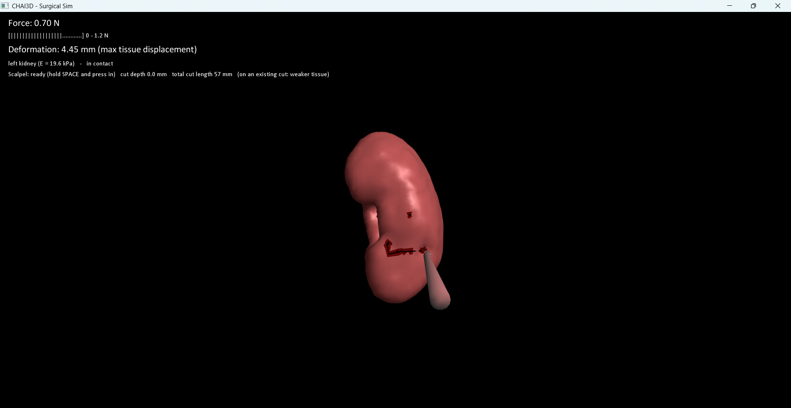
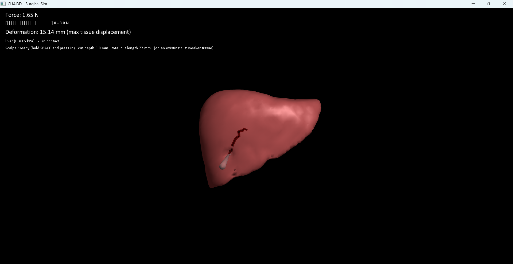
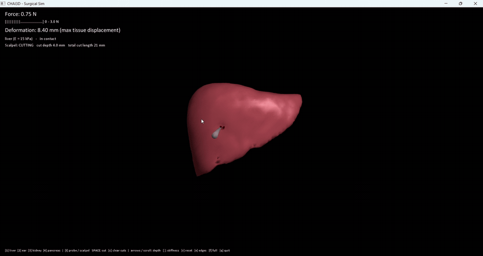
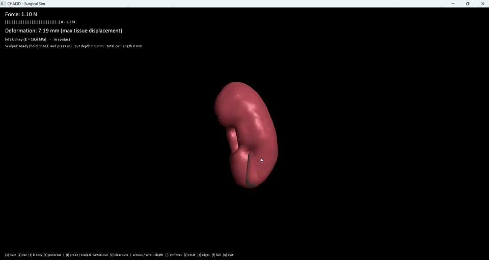
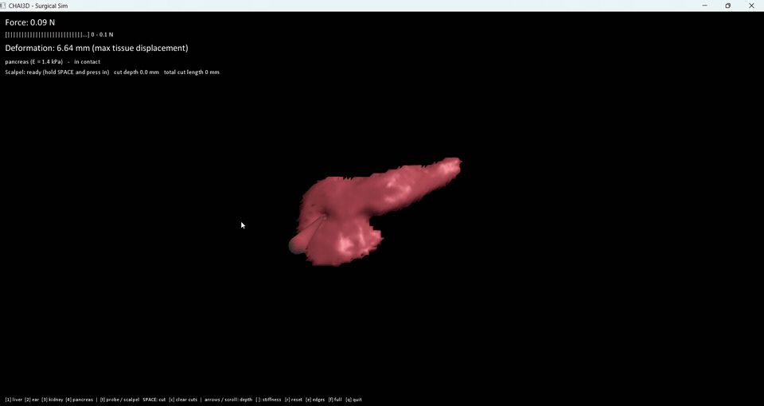
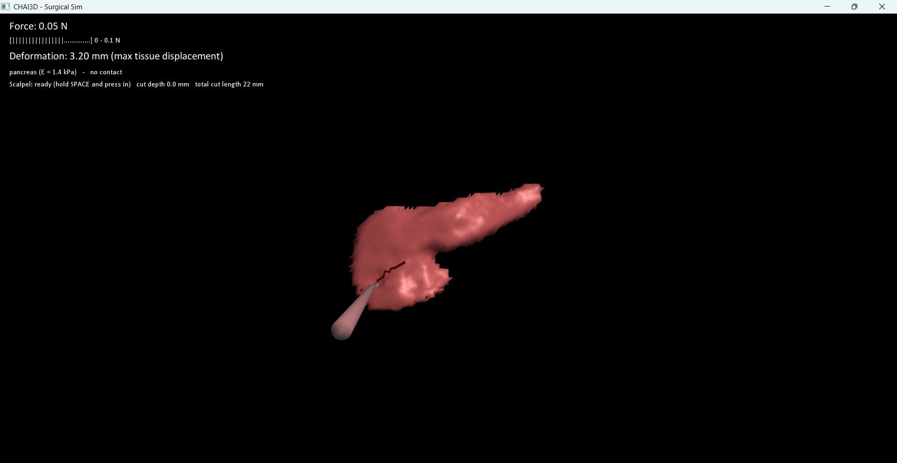

# Soft-Organ Scalpel Simulation

## Overview

This application extends deformable anatomical tissue
simulation to investigate surgical incision and
cutting-force estimation.

The framework supports both probe-based palpation
and scalpel-based surface interaction across liver,
ear cartilage, kidney and pancreas models.

## Computational Approach

The incision model combines:

- Tensor-mass tissue deformation.
- Proxy-based instrument interaction.
- Fracture-energy-based cutting-force estimation.
- Barycentric anchoring of incision points.
- Deformation-dependent incision visualization.
- Reduced force limits along existing incisions.

## Cutting-Force Model

The characteristic cutting force is estimated using
a simplified steady-cutting relationship:

```math
F_c=Jd
```

where:

- F_c is the estimated cutting force.
- J is the work of fracture per unit crack area.
- d is the incision depth.

The calculated force is used to limit the load
applied to the tissue during cutting.

The incision depth follows the instrument's
penetration relative to the virtual proxy and is
restricted to shallow surface cuts.

## Incision Representation

Incisions are represented as sequences of points
anchored to surface triangles using barycentric
coordinates.

This allows the incision geometry to move and
stretch with the deforming tissue surface.

The underlying tetrahedral mesh remains unchanged.

## Model Parameters

| Parameter | Value |
|---|---:|
| Work of fracture | 200 J/m² |
| Cutting initiation threshold | 0.15 N |
| Maximum incision depth | 4 mm |
| Existing-incision force-limit factor | 0.6 |
| Incision sampling distance | 0.5 mm |
| Depth smoothing time constant | 0.08 s |

The work-of-fracture parameter is informed by
published liver studies and assumed for the
other anatomical models.

The remaining parameters represent prototype
interaction settings rather than experimentally
calibrated tissue properties.

## Key Features

- Switching between probe and scalpel instruments.
- Interactive surface incision.
- Tissue deformation during instrument interaction.
- Incision depth and accumulated length visualization.
- Reduced force limits when crossing existing incisions.
- Tissue-specific force limits.

## Visual Demonstrations

### Surface Incision Across Anatomical Models

| Ear cartilage | Left kidney |
| :---: | :---: |
|  |  |
| **Liver** | **Pancreas** |
|  |  |

The incision geometry is anchored to the tissue
surface and follows its deformation during
instrument interaction.

### Interactive Scalpel Demonstrations

#### Liver

<p align="center">
  
</p>

#### Kidney

<p align="center">
  
</p>

#### Pancreas

<p align="center">
  
</p>

### Incision Geometry

| Pancreas incision example 1 | Pancreas incision example 2 |
| :---: | :---: |
|  |  |
| Accumulated length: 39 mm | Accumulated length: 22 mm |

### Representative Simulation Outputs

| Tissue | Displayed force | Maximum displacement | Accumulated incision length |
|---|---:|---:|---:|
| Ear cartilage | 1.80 N | 0.10 mm | 35 mm |
| Kidney | 0.70 N | 4.45 mm | 57 mm |
| Liver | 1.65 N | 15.14 mm | 77 mm |
| Pancreas | 0.06 N | 3.85 mm | 39 mm |

The displayed values correspond to individual
simulation snapshots following incision.

They do not represent experimentally validated
cutting forces or standardized tissue fracture tests.

The incision model does not separate the underlying
volumetric mesh or simulate physical crack opening.

## Implementation

| File | Responsibility |
|---|---|
| `44-soft-organ-scalpel.cpp` | Graphical application and instrument control |
| `scalpel.h` | Incision representation and cutting-force model |
| `surgical_sim.h` | Tissue–instrument interaction |
| `tensor_mass.h` | Mechanical formulation |
| `tensor_mass_dynamics.h` | Numerical integration |
| `organs.h` | Anatomical model configurations |

## Limitations

- Surface incisions only.
- No volumetric mesh separation or remeshing.
- No crack opening under tensile loading.
- No blade friction or bleeding model.
- Assumed fracture parameters for non-liver tissues.
- No experimental validation of cutting forces.
- No physical haptic feedback in the archived code.

The application is intended as a computational
prototype for interactive surgical incision rather
than a complete biological tissue fracture model.

## Related Documentation

- [Computational Methodology](../../docs/METHODOLOGY.md)
- [System Architecture](../../docs/ARCHITECTURE.md)
- [Material Parameters](../../docs/MATERIALS.md)
- [Numerical Verification](../../validation/README.md)
- [Project Overview](../../README.md)
