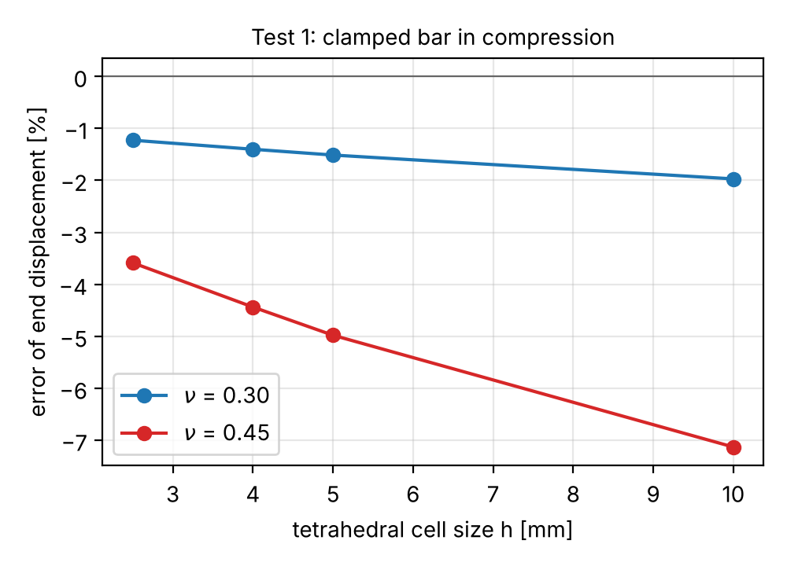
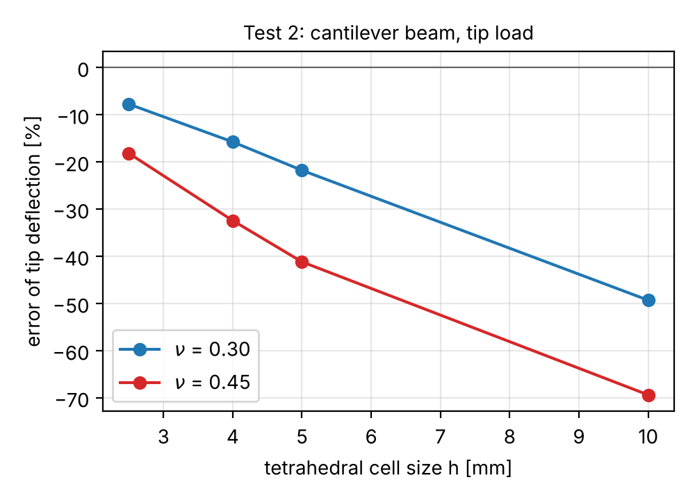
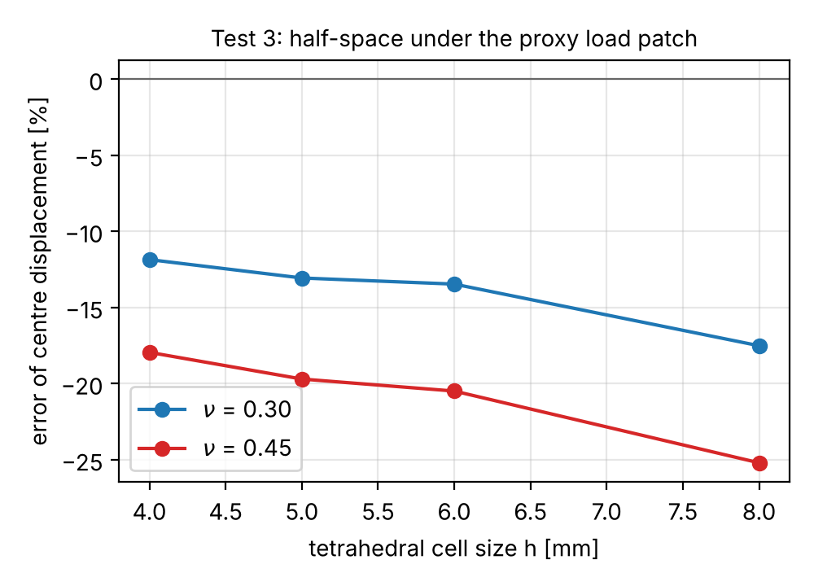
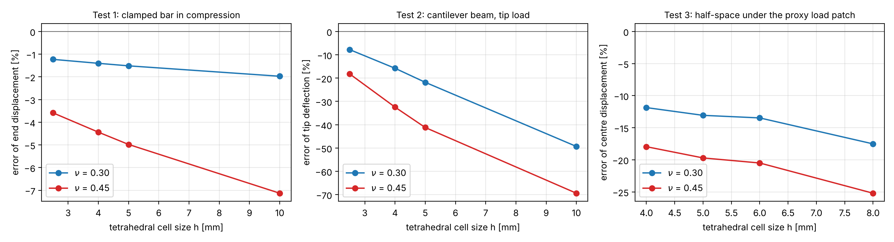

# Numerical Verification of the Tensor-Mass Model

## 1. Overview

The tensor-mass formulation and tissue–instrument interaction
model were investigated through four numerical experiments.

The objectives of these experiments were to:

- Assess the accuracy of the tissue deformation model against
  analytical solutions.
- Investigate the influence of tetrahedral mesh resolution.
- Examine the effect of Poisson's ratio on numerical accuracy.
- Evaluate tissue response under distributed contact loading.
- Investigate the behaviour of the integrated proxy contact model.

The experiments were performed independently of the graphical
surgical simulation environment to isolate the computational
behaviour of the underlying models.

## 2. Experimental Methodology

The numerical experiments use a linear-elastic material model
with a Young's modulus of 15 kPa, representative of the liver
material parameter adopted in the surgical simulator.

The computational domain is discretized using tetrahedral
elements. Damped explicit time integration is used to relax
the loaded structure towards static equilibrium.

### Common Parameters

| Parameter | Value |
|---|---|
| Young's modulus (E) | 15 kPa |
| Poisson's ratio (ν) | 0.30, 0.45 |
| Reference material density | 1060 kg/m³ |
| Element type | Linear tetrahedral |
| Integration scheme | Explicit central difference |

The signed relative displacement error is defined as:

```math
\epsilon = \frac{u_{\mathrm{numerical}}-u_{\mathrm{analytical}}}{u_{\mathrm{analytical}}}\times 100\%
```

Negative values indicate that the numerical model
underestimates the analytical displacement.

## 3. Test 1 — Uniaxial Compression

### Objective

To assess the accuracy of the tensor-mass formulation under
uniaxial compressive loading.

### Experimental Configuration

A rectangular bar is clamped at one end and subjected to
a distributed compressive force at the opposite end.

| Parameter | Value |
|---|---|
| Bar length | 60 mm |
| Cross-section | 20 × 20 mm |
| Applied force | 0.10 N |
| Tetrahedral cell sizes | 2.5, 4, 5, 10 mm |
| Poisson's ratio | 0.30, 0.45 |

### Analytical Reference

The axial displacement is given by:

```math
\delta = \frac{FL}{AE}
```

where:

- F is the applied axial force.
- L is the bar length.
- A is the cross-sectional area.
- E is Young's modulus.

The analytical displacement for the selected configuration
is 1.0 mm.

### Results



| Cell size (mm) | Error, ν = 0.30 | Error, ν = 0.45 |
|---:|---:|---:|
| 10.0 | -1.97% | -7.13% |
| 5.0 | -1.51% | -4.98% |
| 4.0 | -1.40% | -4.44% |
| 2.5 | -1.23% | -3.59% |

### Discussion

The numerical model demonstrates close agreement with the
analytical axial displacement, particularly for ν = 0.30.

Mesh refinement reduces the displacement error for both
Poisson's ratios.

The remaining discrepancy is consistent with the influence
of the clamped boundary condition and volumetric locking
associated with linear tetrahedral elements at higher
Poisson's ratios.

The lowest observed absolute error is 1.23%.

## 4. Test 2 — Cantilever Beam under Tip Loading

### Objective

To investigate bending accuracy and the influence of mesh
resolution on the deformation response.

### Experimental Configuration

A rectangular cantilever beam is fixed at one end and
subjected to a transverse load at its free end.

| Parameter | Value |
|---|---|
| Beam length | 100 mm |
| Cross-section | 20 × 20 mm |
| Applied transverse force | 0.0012 N |
| Tetrahedral cell sizes | 2.5, 4, 5, 10 mm |
| Poisson's ratio | 0.30, 0.45 |

### Analytical Reference

The analytical tip displacement is calculated using
Timoshenko beam theory, accounting for bending and
transverse shear deformation:

```math
\delta = \frac{FL^3}{3EI}+\frac{FL}{\kappa GA}
```
where:

- I is the second moment of area.
- G is the shear modulus.
- κ is the shear correction factor, taken as 5/6.

The shear modulus is calculated as:

```math
G = \frac{E}{2(1+\nu)}
```

### Results



| Cell size (mm) | Error, ν = 0.30 | Error, ν = 0.45 |
|---:|---:|---:|
| 10.0 | -49.33% | -69.40% |
| 5.0 | -21.80% | -41.20% |
| 4.0 | -15.78% | -32.45% |
| 2.5 | -7.77% | -18.20% |

### Discussion

The numerical model exhibits considerable stiffness in
bending-dominated configurations at coarse mesh resolutions.

This behaviour is consistent with the limitations of
constant-strain tetrahedral elements, including shear
locking and volumetric locking.

Mesh refinement substantially improves the numerical
response. For ν = 0.30, the absolute displacement error
decreases from 49.33% to 7.77%.

The results demonstrate the importance of mesh resolution
when modelling bending-dominated tissue deformation.

## 5. Test 3 — Elastic Half-Space under Distributed Loading

### Objective

To evaluate the deformation response of the tissue model
under a distributed load representative of the surgical
probe's contact patch.

This experiment isolates the solid deformation model
from the integrated proxy contact loop.

### Experimental Configuration

| Parameter | Value |
|---|---|
| Applied force | 0.30 N |
| Load patch radius | 10 mm |
| Tetrahedral cell sizes | 4, 5, 6, 8 mm |
| Poisson's ratio | 0.30, 0.45 |

The radial pressure distribution is defined as:

```math
p(r)=p_0\left(1-\frac{r}{\rho}\right)^2
```
within the circular loading region, where ρ is the
load patch radius.

### Analytical Reference

Using the elastic half-space solution for the specified
axisymmetric pressure distribution, the centre displacement
is given by:

```math
w_0=\frac{4F(1-\nu^2)}{\pi E\rho}
```
### Results



| Cell size (mm) | Error, ν = 0.30 | Error, ν = 0.45 |
|---:|---:|---:|
| 8.0 | -17.52% | -25.21% |
| 6.0 | -13.47% | -20.50% |
| 5.0 | -13.07% | -19.71% |
| 4.0 | -11.86% | -17.95% |

### Discussion

The numerical model consistently underestimates the
analytical centre displacement.

Mesh refinement improves agreement with the analytical
solution for both Poisson's ratios.

The discrepancy can be attributed in part to spatial
discretization and the additional stiffness introduced
by the finite computational domain relative to the
ideal elastic half-space.

The lowest observed absolute error is 11.86%.

This experiment provides numerical evidence of the
tissue model's response to distributed instrument loading.

## 6. Test 4 — Integrated Proxy Contact Model

### Objective

To investigate the force–indentation behaviour of the
complete proxy-based tissue interaction model.

Unlike Test 3, the applied contact force is determined
through the hand–proxy coupling spring rather than
prescribed directly.

### Experimental Configuration

| Parameter | Value |
|---|---|
| Young's modulus | 15 kPa |
| Poisson's ratio | 0.45 |
| Tetrahedral cell sizes | 5, 8 mm |
| Prescribed hand depths | 1, 2 mm |
| Coupling stiffness | 800 N/m |
| Probe radius | 1.25 mm |

### Results

| Cell size (mm) | Hand depth (mm) | Force (N) | Proxy indentation (mm) | Maximum tissue displacement (mm) | Contact state |
|---:|---:|---:|---:|---:|---|
| 8 | 1 | 0.272 | 0.661 | 1.305 | Static |
| 8 | 2 | 0.386 | 1.492 | 1.894 | Unsteady |
| 5 | 1 | 0.150 | 0.802 | 1.225 | Unsteady |
| 5 | 2 | 0.302 | 1.608 | 2.380 | Static |

### Comparison with Analytical Reference

| Cell size (mm) | Hand depth (mm) | Analytical displacement (mm) | Proxy error | Tissue displacement error |
|---:|---:|---:|---:|---:|
| 8 | 1 | 1.682 | -60.7% | -22.4% |
| 8 | 2 | 2.391 | -37.6% | -20.8% |
| 5 | 1 | 1.485 | -46.0% | -17.5% |
| 5 | 2 | 2.998 | -46.4% | -20.6% |

### Discussion

The integrated contact model exhibits greater discrepancies
than the isolated solid deformation experiments.

The proxy position does not necessarily coincide with the
deepest point of the deformed tissue surface. Contact
activation and deactivation can also introduce oscillatory
behaviour.

Two of the four tested configurations exhibit unsteady
contact and are therefore unsuitable for quantitative
static comparison.

The maximum tissue displacement provides a more informative
indicator of tissue response than the proxy indentation alone.

The analytical half-space solution is used here as a
reference for interpretation, rather than an exact solution
of the coupled proxy contact system.

Consequently, the integrated contact model is treated as
a qualitative instrument interaction model rather than a
quantitatively validated contact mechanics formulation.

## 7. Comparative Analysis



### Effect of Mesh Refinement

The table below summarizes the absolute displacement errors
at the coarsest and finest tested mesh resolutions.

| Experiment | Poisson's ratio | Coarsest mesh error | Finest mesh error |
|---|---:|---:|---:|
| Uniaxial compression | 0.30 | 1.97% | 1.23% |
| Uniaxial compression | 0.45 | 7.13% | 3.59% |
| Cantilever bending | 0.30 | 49.33% | 7.77% |
| Cantilever bending | 0.45 | 69.40% | 18.20% |
| Distributed indentation | 0.30 | 17.52% | 11.86% |
| Distributed indentation | 0.45 | 25.21% | 17.95% |

### Key Findings

- The tensor-mass model demonstrates close agreement with
  analytical solutions under uniaxial loading.

- Mesh refinement improves displacement accuracy in all
  six investigated solid deformation configurations.

- Bending-dominated deformation is particularly sensitive
  to tetrahedral mesh resolution.

- Higher Poisson's ratios result in increased numerical
  stiffness, consistent with volumetric locking.

- Distributed contact loading demonstrates improved
  agreement with analytical predictions as the mesh
  resolution increases.

- The integrated proxy contact model requires further
  investigation for quantitative force–indentation accuracy.

## 8. Limitations

- Linear-elastic material assumptions.
- Constant-strain tetrahedral discretization.
- Shear and volumetric locking.
- Finite computational domains used to approximate
  analytical half-space conditions.
- Sensitivity of the contact model to proxy positioning
  and contact cycling.
- Absence of experimental comparisons against physical
  biological tissue measurements.

These experiments constitute numerical verification of the
computational models. They do not establish clinical
validity, physical haptic feedback accuracy or surgical
training effectiveness.

## 9. Experimental Records

The original implementation and recorded experimental
outputs are retained as documentation of the numerical
investigation.

- [Validation implementation](validation.cpp)
- [Original experimental data](results/validation_results.csv)
- [Recorded experimental output](results/example_output_from_my_run.txt)
- [Figure generation script](make_plots.py)
- [Individual validation figures](figures/)

## 10. Conclusion

The numerical experiments demonstrate the capabilities
and limitations of the tensor-mass formulation for
interactive surgical simulation.

The model provides accurate axial deformation predictions
and exhibits improved bending and indentation accuracy
with mesh refinement.

The findings establish a numerical foundation for the
deformable tissue simulation while identifying limitations
associated with tetrahedral discretization and integrated
instrument contact.
